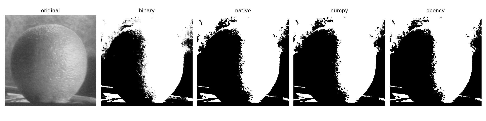

# ЛР1. Эрозия с примитивом 3×3

Вариант 7.

## 1. Теоретическая база

Эрозия — морфологическая операция, уменьшающая светлые области изображения. Для каждого пикселя вычисляется минимум значений в окрестности, заданной структурным элементом. В работе используется ядро 3×3 из единиц.

На бинарном изображении пиксели принимают два значения: 0 и 1. В данной реализации используются их 8-битные эквиваленты: 0 (чёрный) и 255 (белый). Пиксель остаётся белым, только если все девять пикселей его окрестности белые.

Эрозия сужает белые объекты, увеличивает отверстия внутри них и удаляет мелкие светлые детали.

## 2. Описание системы

Вся программа находится в `main.py`:

- `erosion_native` — реализация на Python с перебором каждого пикселя и поиском минимума среди девяти соседей;
- `erosion_numpy` — векторизованная реализация через девять срезов массива и `np.minimum`;
- `erosion_opencv` — библиотечная реализация через `cv2.erode`;
- `benchmark` — измерение времени выполнения;
- `main` — загрузка изображения, бинаризация, сравнение реализаций и сохранение результатов.

Изображение `assets/orange.jpg` загружается в оттенках серого и бинаризуется с порогом 127. Затем выполняется эрозия тремя способами с одинаковым ядром 3×3 и дополнением границ значением 255.

Результаты сравниваются попиксельно.

Запуск:

```bash
uv sync
uv run main.py
```

## 3. Результаты

Изображение 512×512, порог бинаризации 127.

Сравнение результатов трёх реализаций:



Время работы (macOS, arm64):

| Реализация | Время, мс | Ускорение |
|---|---:|---:|
| Python | 207,408 | 1× |
| NumPy | 0,110 | ~1884.1× |
| OpenCV | 0,020 | ~10169.0× |

Время измерялось для 20 запусков каждой функции без учёта загрузки и сохранения изображений.

Результаты всех реализаций совпали попиксельно. Количество белых пикселей уменьшилось с 142 026 до 126 707.

## 4. Выводы

- Наивная реализация значительно медленнее из-за обработки каждого пикселя и его соседей в циклах Python.
- Векторизация NumPy ускоряет вычисления за счёт обработки целых массивов. OpenCV показал наименьшее время выполнения благодаря оптимизированной библиотечной реализации.
- При фиксированном ядре 3×3 все три реализации имеют линейную сложность относительно числа пикселей — O(H × W). Разница в скорости связана с накладными расходами Python и оптимизациями библиотечного кода, которые не отражаются в асимптотической оценке.

## 5. Источники

1. Гонсалес Р., Вудс Р. Цифровая обработка изображений. — М.: Техносфера, 2012.
2. [OpenCV: Eroding and Dilating](https://docs.opencv.org/4.13.0/db/df6/tutorial_erosion_dilatation.html).
3. [OpenCV: функция erode](https://docs.opencv.org/4.13.0/d4/d86/group__imgproc__filter.html#ga1d6b55d1c114bca73a9f16045bfee982).
4. [Towards Data Science: Image Processing — Part 3](https://towardsdatascience.com/image-processing-part-3-dbf103622909/).
5. [OpenCV: тестовое изображение orange.jpg](https://github.com/opencv/opencv/blob/4.x/samples/data/orange.jpg).