# ЛР2. Отслеживание объекта на видео

## 1. Теоретическая база

- **Ключевая точка** — характерная точка изображения, например угол, которую можно повторно найти на другом кадре.
- **Дескриптор** — числовое описание окрестности ключевой точки, используемое для поиска соответствий.
- **ORB** — метод обнаружения ключевых точек на основе FAST и построения бинарных дескрипторов на основе BRIEF с учётом ориентации точки.
- **SIFT** — метод поиска ключевых точек на разных масштабах и описания их окрестностей по направлениям изменения яркости. Устойчив к изменению масштаба и повороту.
- **BFMatcher** — поиск соответствий полным перебором дескрипторов. Для ORB используется расстояние Хэмминга, для SIFT — евклидово расстояние.
- **Тест Лоу** — отбор однозначных соответствий: расстояние до лучшего кандидата должно быть существенно меньше расстояния до второго.
- **Гомография** — проективное преобразование, описывающее положение плоского объекта на другом изображении. Задается матрицей 3×3.
- **RANSAC** — метод оценки модели при наличии ошибочных соответствий: проверяет случайные подмножества точек и выбирает модель с наибольшей поддержкой.
- **Инлайеры** — соответствия, согласующиеся с найденным преобразованием в пределах заданной погрешности.
- **Оптический поток** — видимое смещение точек изображения между соседними кадрами.
- **Метод Лукаса–Канаде** — вычисление оптического потока по изменениям яркости в окрестности точки. Пирамидальная версия использует уменьшенные копии изображений для обработки более крупных перемещений.
- **Дрейф** — постепенное смещение рамки относительно объекта из-за накопления ошибок отслеживания.
- **Взвешенное объединение оценок** — вычисление итоговой оценки как суммы исходных оценок с заданными весами.
- **IoU** — отношение площади пересечения двух фигур к площади их объединения, по сути мера их перекрытия.

## 2. Описание системы

Программа читает видео по кадрам. Для поиска признаков кадры переводятся в оттенки серого, а исходные цветные изображения сохраняются для отрисовки рамки. Первый кадр целиком используется как эталон, его ключевые точки и дескрипторы вычисляются один раз.

В базовом варианте каждый следующий кадр независимо сопоставляется с эталоном. По найденным соответствиям вычисляется гомография с RANSAC. Она переносит четыре угла эталона на текущий кадр. Если соответствий недостаточно или преобразование некорректно, кадр записывается без рамки.

Первый кадр `mona-lisa.avi`, используемый как эталон:

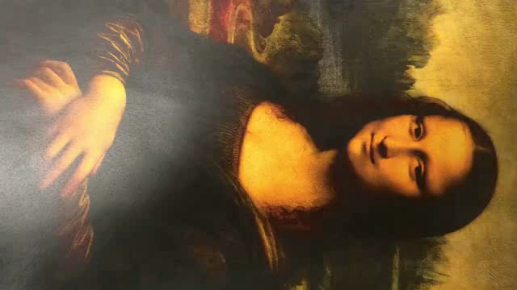

Сначала для поиска признаков использовался ORB. Когда камера находится близко к картине, соответствий хватает для определения рамки. При отдалении камеры объект становится меньше, и ORB теряет подходящие совпадения. Попытался исправить это заменой ORB на SIFT, сохранив остальной алгоритм.

ORB и SIFT запущены отдельно по всему `mona-lisa.avi`. В обоих случаях используются 1000 признаков, коэффициент теста Лоу `0,75`, не менее восьми инлайеров и одинаковые проверки геометрии рамки.

| Кадр | ORB | SIFT |
|---|---|---|
| 61: объект найден обоими методами | 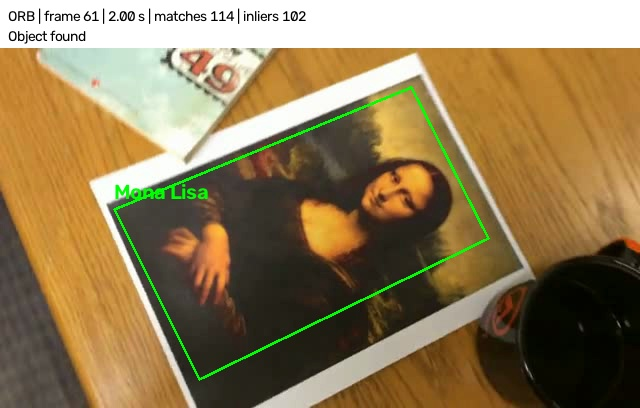 |  |
| 139: ORB теряет объект, SIFT еще находит | 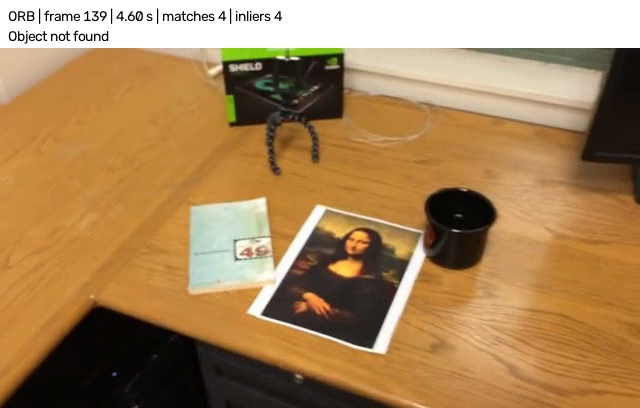 | 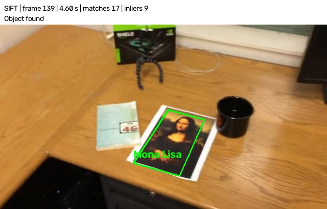 |
| 279: объект не найден обоими методами |  | 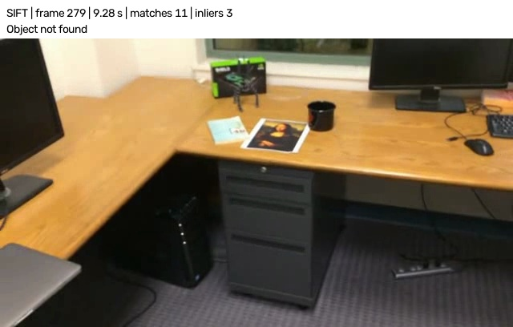 |

SIFT помогает на кадре 139, но на кадре 279 оба метода теряют объект. Одной замены детектора оказалось недостаточно.

Затем добавил метод Лукаса–Канаде: он переносит найденные точки между соседними кадрами, а гомография — рамку. SIFT в этой версии используется для начального обнаружения и восстановления после потери.

На кадре 279 независимый SIFT дает три инлайера, а отслеживание между соседними кадрами — 217. Рамка сохраняется даже на дальнем плане. Лукас–Канаде также запущен отдельно по всему видео:

| Независимый поиск SIFT | Лукас–Канаде |
|---|---|
|  | 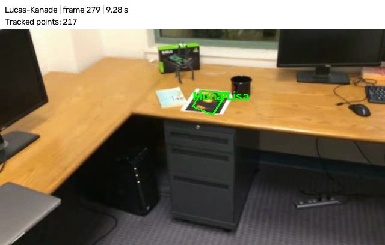 |

Однако ошибки переноса накапливаются: при возвращении камеры к картине рамка уже смещена. Пока поток не потерян, SIFT не вызывается и дрейф не исправляется.

Для уменьшения дрейфа добавил взвешенную коррекцию рамки по SIFT. Сопоставление с эталоном выполняется на каждом кадре, а при надежном результате рамки объединяются:

$$
B = (1-\alpha)B_{\text{flow}} + \alpha B_{\text{SIFT}}, \qquad \alpha = 0{,}2,
$$

Здесь $B$ — координаты четырех углов. Скорректированная рамка используется на следующем кадре.

Сравнение отдельных прогонов Лукаса–Канаде и варианта с коррекцией по SIFT. На кадрах 400 и 418 заметен наклон рамки потока относительно картины, коррекция уменьшает это расхождение:

| Кадр | Лукас–Канаде | Коррекция по SIFT, α=0.2 |
|---|---|---|
| 400 | 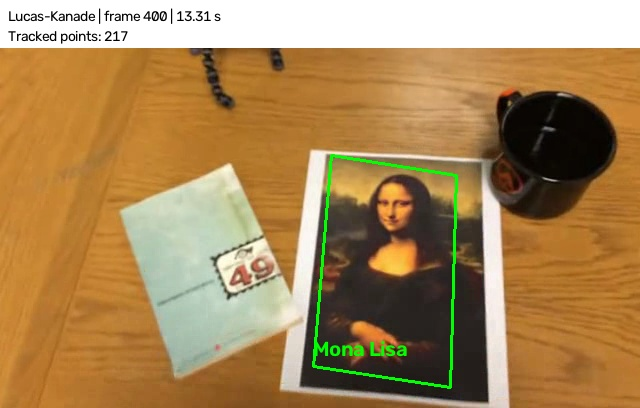 | 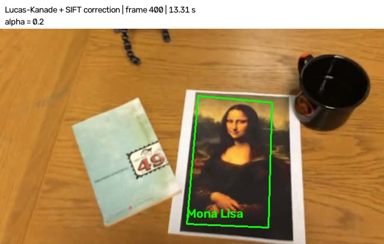 |
| 418 | 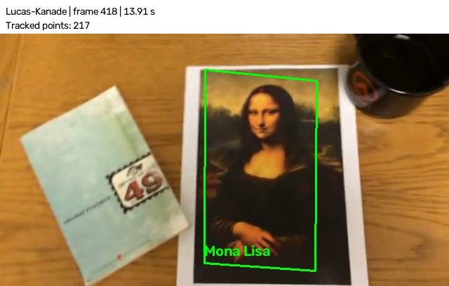 | 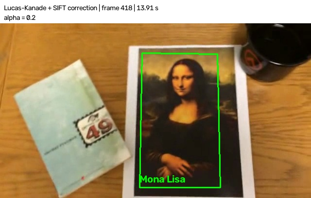 |

SIFT-коррекция проверяется по инлайерам и геометрии рамки. При меньшей уверенности требуется также согласованность с потоком. Ненадежная оценка отбрасывается. Если потеряны и поток, и обнаружение по SIFT, кадр записывается без рамки.

Итоговая схема обработки:
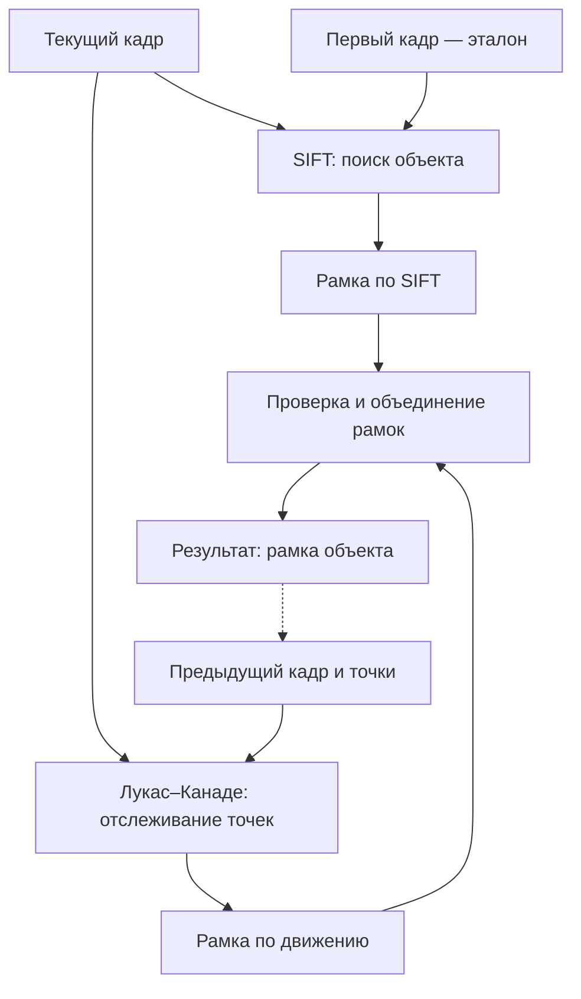

## 3. Результаты

Итоговая версия проверена на трех вариантах видео с Моной Лизой и собственном видео с джойстиком. Все входные AVI имеют разрешение 640×360 и частоту около 29,97 FPS; запись с джойстиком предварительно приведена к этому формату.

| Видео | Обработано кадров | Кадров с рамкой | Доля | SIFT-коррекций |
|---|---:|---:|---:|---:|
| mona-lisa | 558 | 557/557 | 100% | 208 |
| mona-lisa-blur | 558 | 538/557 | 96,6% | 188 |
| mona-lisa-blur-extra-credit | 558 | 529/557 | 95,0% | 184 |
| joystick | 568 | 458/567 | 80,8% | 41 |

Первый кадр используется как эталон и не входит в число проверяемых кадров. Коррекции считаются отдельно от начального обнаружения и восстановления после потери. Все выходные видео полностью декодируются, число кадров, разрешение и FPS сохранены.

Наличие рамки не означает, что ее углы определены точно. Ручной разметки нет, поэтому геометрическая точность оценивается визуально. Сравнение на кадрах 400 и 418 выше показывает, как коррекция уменьшает видимый дрейф.

На размытых кадрах объект теряется, но после возвращения четкого изображения отслеживание восстанавливается:

| Видео | Потеря при размытии | Отслеживание после восстановления |
|---|---|---|
| mona-lisa-blur | Кадр 11 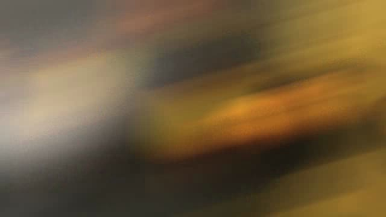 | Кадр 418  |
| mona-lisa-blur-extra-credit | Кадр 12 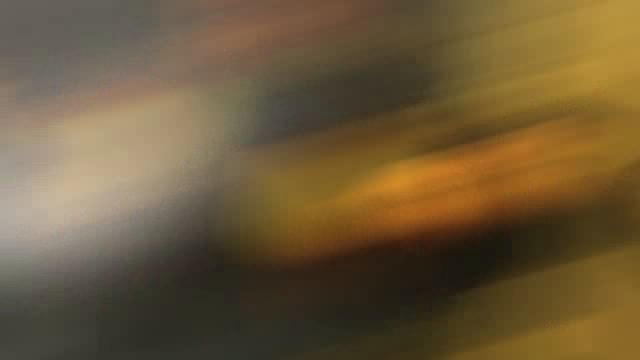 | Кадр 418 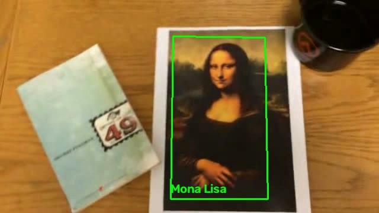 |

На собственном видео рамка удерживается не при всех ракурсах, на некоторых растягивается, это особо видно при отдалении, а при сильном повороте объект теряется:

| Кадр 61: объект отслеживается | Кадр 142: рамка искажена | Кадр 426: объект потерян |
|---|---|---|
| 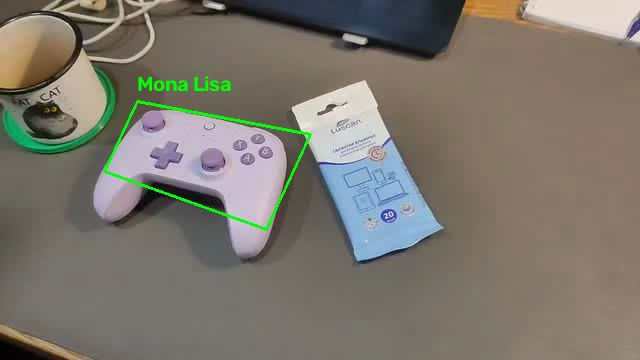 | 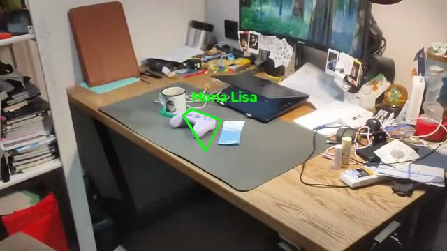 | 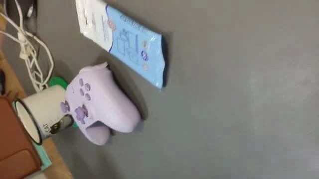 |

Основные ограничения — недостаток различимых признаков на дальнем плане, однотонный цвет джойстика, сильное размытие и накопление ошибок оптического потока. Геометрические проверки отбрасывают очевидно некорректные рамки, но не гарантируют совпадения с границами объекта. Джойстик также является объемным объектом: при изменении ракурса одна гомография не всегда корректно описывает движение всех его частей. 

## 4. Выводы

- SIFT позволил находить объект в части кадров, где ORB уже терял соответствия, но независимого поиска оказалось недостаточно для дальних планов.
- Метод Лукаса–Канаде использовал непрерывность движения и сохранил рамку на всех проверяемых кадрах `mona-lisa.avi`. При последовательном переносе появился дрейф.
- Коррекция по SIFT с весом 0,2 уменьшила видимое смещение рамки на рассмотренных примерах, сохранив оптический поток основным способом отслеживания.
- Сильное размытие, изменение ракурса и объемная форма объекта остаются ограничениями. Доля кадров с рамкой характеризует непрерывность работы, но не точность локализации.

## 5. Источники

1. [OpenCV: Features2D + Homography to find a known object](https://docs.opencv.org/4.x/d7/dff/tutorial_feature_homography.html).
2. [OpenCV: Optical Flow](https://docs.opencv.org/4.x/d4/dee/tutorial_optical_flow.html).
3. [OpenCV: AKAZE and ORB planar tracking](https://docs.opencv.org/4.x/dc/d16/tutorial_akaze_tracking.html).
