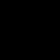
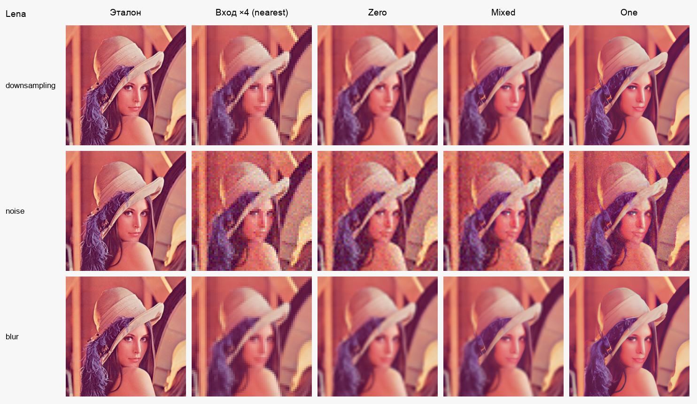
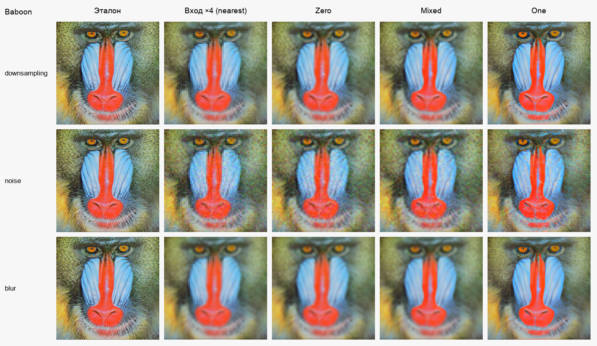
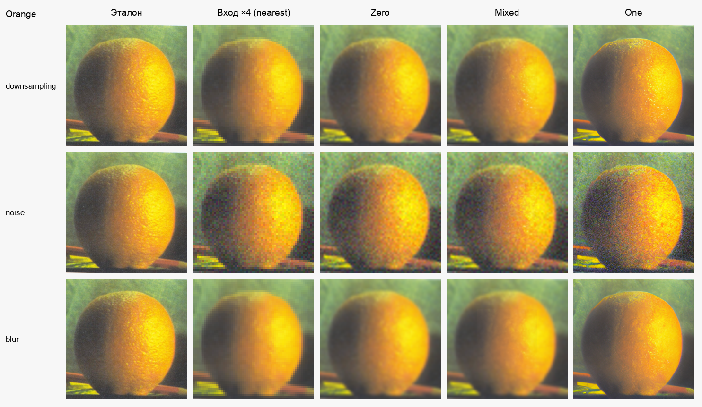
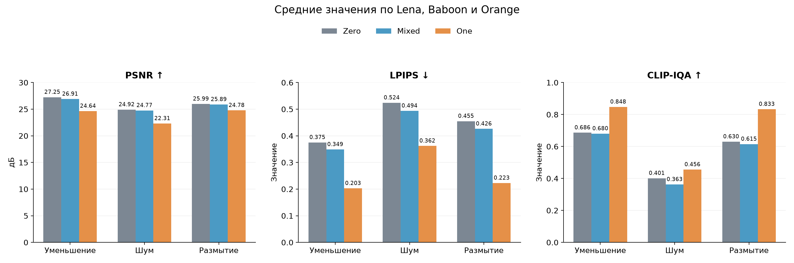

# ЛР3. Диффузионное восстановление изображения по маске

Цель работы — разобраться в устройстве диффузионных image-to-image моделей и модифицировать процесс сэмплинга для восстановления заданной области изображения (SR-inpainting).

## 1. Теоретическая база

- **Super-resolution (SR)** — восстановление изображения с повышением разрешения. Нейросеть может генерировать детали, отсутствующие во входном изображении.
- **Интерполяция** — вычисление значений новых пикселей на основе существующих. Бикубическая интерполяция учитывает значения соседних пикселей, обеспечивая плавные переходы.
- **Деградация** — ухудшение качества изображения, например уменьшение разрешения, добавление шума или размытие.
- **Диффузионная модель** — генеративная модель, обученная обращать процесс постепенного зашумления данных. При генерации модель начинает со случайного шума и последовательно удаляет его.
- **Image-to-image** — генерация изображения на основе другого изображения. В данной работе условием генерации является изображение низкого разрешения.
- **Латентное пространство** — пространство числовых представлений изображений. Работа с компактными представлениями вместо исходных пикселей позволяет снизить вычислительные затраты.
- **VQVAE** — автоэнкодер с векторным квантованием. Энкодер переводит изображение в латентное представление, декодер восстанавливает изображение из него.
- **U-Net** — нейросеть с архитектурой энкодер-декодер и соединениями между соответствующими уровнями. В используемой модели предсказывает шум с учетом входного изображения.
- **Сэмплинг** — процесс получения результата из начального случайного шума с помощью обученной диффузионной модели.
- **DDIM** — алгоритм сэмплинга, позволяющий выполнять генерацию за сокращенное число шагов на основе предсказаний шума.
- **Бинарная маска** — массив из нулей и единиц, определяющий область восстановления. Единица соответствует восстанавливаемой области, ноль — сохраняемой.

Для оценки качества используются три метрики:

- **PSNR** — метрика, основанная на средней квадратичной ошибке между пикселями результата и эталона. Измеряется в децибелах, большее значение соответствует меньшей ошибке.
- **LPIPS** — мера различия между признаками двух изображений, извлеченными предобученной нейросетью. Учитывает различия в формах и текстурах, а не только в значениях отдельных пикселей. Чем меньше значение, тем выше визуальное сходство по этой метрике.
- **CLIP-IQA** — метрика оценки качества изображения без эталона. Использует модель CLIP для сравнения изображения с противоположными текстовыми описаниями (`Good photo.` и `Bad photo.`). Принимает значения от 0 до 1, большее значение соответствует более высокой оценке качества.

## 2. Описание системы

### Модель

В работе используется предобученная модель `CompVis/ldm-super-resolution-4x-openimages` из библиотеки Diffusers. Модель увеличивает разрешение изображения в четыре раза и выполняет диффузию в латентном пространстве. Она выбрана с учетом возможности локального запуска на CPU. Дополнительное обучение не проводится.

Входное изображение размером 64×64 используется как условие генерации. Начальные латенты создаются из случайного шума. На каждой итерации латенты и входное изображение объединяются по каналам, U-Net предсказывает шум, а DDIM вычисляет следующее состояние латентов. После завершения сэмплинга декодер VQVAE формирует изображение размером 256×256.

### Восстановление по маске

На основе исходного `LDMSuperResolutionPipeline` реализовал цикл семплинга (аналогичный библиотечному pipeline). Затем модифицировал его для восстановления отдельных областей изображения.

Алгоритм работы:

1. Входное изображение увеличивается бикубической интерполяцией до 256×256. Оно используется как основа для сохраняемой области.
2. Увеличенное изображение переводится в латентное пространство с помощью энкодера VQVAE. Размер латентов и бинарной маски по пространственным измерениям составляет 64×64.
3. Генерируется начальный случайный шум.
4. На каждой итерации U-Net предсказывает шум, а DDIM выполняет шаг удаления шума.
5. После каждого шага латенты вне маски заменяются латентами бикубически увеличенного изображения. Перед заменой к ним добавляется шум, соответствующий следующему шагу диффузии. Используется тот же случайный шум, с которого началась генерация. На последней итерации сохраняемые латенты берутся без шума.
6. Полученные латенты преобразуются в изображение декодером VQVAE.
7. Маска увеличивается до 256×256 методом ближайшего соседа. Пиксели внутри маски берутся из результата модели, а вне маски — из бикубически увеличенного изображения.

Добавление шума на пятом шаге необходимо, чтобы сохраняемая и генерируемая области находились на одинаковом уровне зашумления. На следующей итерации модель учитывает уже измененные латенты. Таким образом, маска влияет на сам процесс генерации.

Повторное применение маски после декодирования необходимо, поскольку VQVAE не гарантирует точного восстановления пикселей при кодировании и декодировании. Объединение изображений позволяет сохранить пиксели вне маски без изменений относительно бикубической интерполяции.


### Реализация

Программа разделена на три файла:

- `main.py` — загрузка модели, модифицированный цикл сэмплинга, восстановление изображения по маске
- `evaluate.py` — создание деградаций, перебор изображений и масок, сохранение результатов
- `metrics.py` — вычисление PSNR, LPIPS и CLIP-IQA с помощью TorchMetrics.

Модель загружается один раз для всех экспериментов. Метрики вычисляются по сохраненным изображениям без повторного запуска диффузии.

### Запуск

Используются Python 3.13, PyTorch, Diffusers 0.35.2, Pillow, NumPy и TorchMetrics.

Запуск из директории `lab3`:
```
    uv sync
    uv run main.py
```

## 3. Результаты

Для тестирования использованы изображения `lena.jpg`, `baboon.jpg` и `orange.jpg` из набора примеров OpenCV. Они содержат разные типы деталей: лицо, контуры, сложную текстуру шерсти и поверхность фрукта.

Каждое изображение приведено к размеру 256×256 и используется как эталон (`ground truth`). Из него получены три версии размером 64×64:

- `downsampling` — уменьшение разрешения бикубической интерполяцией;
- `noise` — уменьшение разрешения и добавление гауссовского шума со средним 0 и стандартным отклонением 10 (в диапазоне яркостей 0–255, seed 42);
- `blur` — гауссовское размытие с радиусом 2 перед уменьшением разрешения.

После добавления шума значения обрезаются до диапазона 0–255 и приводятся к `uint8`. Изображение `licenseplate_motion.jpg` не использовалось, поскольку уже содержит деградацию.

Для каждой деградации использованы три варианта маски:

| Zero | One | Mixed |
|---|---|---|
|  |  |  |
| Без диффузионных изменений в результате | Восстановление всего изображения | Восстановление центральной области |

В комбинированной маске центральный квадрат 32×32 занимает четверть площади изображения. Всего получено 27 результатов: 3 изображения × 3 деградации × 3 маски.

Визуальное сравнение. Строки сверху вниз: `downsampling`, `noise`, `blur`. Столбцы слева направо: эталон, входное изображение, Zero, Mixed, One. Входное изображение увеличено методом ближайшего соседа только для отображения.

**Lena**



**Baboon**



**Orange**



При полной маске контуры шляпы и лица Lena становятся четче, но кожа выглядит более сглаженной. У Baboon появляется выраженная фактура шерсти, а у Orange — мелкая фактура кожуры; эти детали не повторяют эталон точно. В строке `noise` цветная зернистость заметна даже после восстановления всего изображения. При Mixed центральный участок отличается по резкости от окружающей области, особенно на Lena; шум вне маски сохраняется.

Для всех девяти комбинаций изображения и деградации результат с нулевой маской попиксельно совпал с бикубически увеличенным входным изображением (9/9). Отдельно проверены все девять результатов с комбинированной маской: в каждом из них все 49 152 пикселя вне маски сохранены точно, максимальная ошибка по каналам равна 0. Проверка выполнена по сохраненным файлам без изменения программы и повторного запуска диффузии.

### Оценка качества

Метрики вычисляются по всему изображению размером 256×256. PSNR и LPIPS сравнивают результат с эталоном до деградации, CLIP-IQA оценивает только результат. Для LPIPS используется предобученная сеть AlexNet.

На графике приведены средние значения метрик по трем исходным изображениям для каждой комбинации деградации и маски. Результат с нулевой маской соответствует обычной бикубической интерполяции и используется для сравнения с диффузионным восстановлением.



При полной маске для всех трех деградаций ухудшается PSNR, улучшаются LPIPS и CLIP-IQA. Модель восстанавливает визуально правдоподобные детали без гарантии их соответствия оригиналу.

Лучшие значения LPIPS и CLIP-IQA получены при полном восстановлении изображений после уменьшения разрешения без дополнительных деградаций. Максимальный PSNR достигнут на тех же изображениях при нулевой маске. Наибольший прирост визуального качества относительно бикубической интерполяции наблюдается при размытии.

Наихудшие значения всех трех метрик при каждом варианте маски получены на зашумленных изображениях. После восстановления на них сохраняется заметная зернистость.

При частичном восстановлении возникает неоднородность качества изображения: центральная область становится более детализированной, окружающая сохраняет исходные деградации. Это может объяснять ухудшение CLIP-IQA при улучшении LPIPS. Метрики рассчитаны по всему изображению, поэтому отдельно качество восстановления участка внутри маски не оценивалось.

## 4. Выводы

- При восстановлении всего изображения для всех трех деградаций улучшаются LPIPS и CLIP-IQA, но снижается PSNR. Модель генерирует визуально правдоподобные детали, которые не обязательно совпадают с деталями оригинала.
- Лучшие значения визуальных метрик получены при восстановлении изображения после обычного уменьшения разрешения. Наибольшее улучшение относительно бикубической интерполяции наблюдается при размытии. Добавление шума оказалось наиболее сложным для модели случаем.
- Комбинированная маска позволяет локально восстанавливать детали без изменения окружающих областей. Однако различие в качестве соседних областей может ухудшать восприятие изображения в целом.
- Результаты получены на трех изображениях с искусственными деградациями и характеризуют работу алгоритма в рамках проведенного эксперимента.

## 5. Источники

1. [Rombach R. et al. High-Resolution Image Synthesis with Latent Diffusion Models. CVPR, 2022](https://arxiv.org/abs/2112.10752).
2. [CompVis: LDM Super Resolution 4×](https://huggingface.co/CompVis/ldm-super-resolution-4x-openimages).
3. [Diffusers 0.35.2: исходный код LDMSuperResolutionPipeline](https://github.com/huggingface/diffusers/blob/v0.35.2/src/diffusers/pipelines/latent_diffusion/pipeline_latent_diffusion_superresolution.py).
4. [Song J., Meng C., Ermon S. Denoising Diffusion Implicit Models. ICLR, 2021](https://arxiv.org/abs/2010.02502).
5. [Zhang R. et al. The Unreasonable Effectiveness of Deep Features as a Perceptual Metric. CVPR, 2018](https://openaccess.thecvf.com/content_cvpr_2018/html/Zhang_The_Unreasonable_Effectiveness_CVPR_2018_paper.html).
6. [Wang J., Chan K. C. K., Loy C. C. Exploring CLIP for Assessing the Look and Feel of Images. AAAI, 2023](https://arxiv.org/abs/2207.12396).
7. [TorchMetrics: документация](https://lightning.ai/docs/torchmetrics/stable/).
8. [OpenCV: тестовые изображения](https://github.com/opencv/opencv/tree/4.x/samples/data) (`lena.jpg`, `baboon.jpg`, `orange.jpg`).
